# 微波网络
## 波导电路参数

令平均功率=1/2VI，得到C1xC2的限制
再任意选取Z0，可以得到C1和C2
通常选取Z0=Zw或1 

## 一端口系统输入阻抗与内部能量

根据上述功率归一化条件：
$$
P=\dfrac{1}{2}\int \vec{E_t}\times \vec{H_t^*}ds=\dfrac{1}{2}V_{in}I_{in}^*=P_l+2jw(W_m-W_e)
\\Z_{in}=\dfrac{V_{in}}{I_{in}}=\dfrac{V_{in}I_{in}^*}{|I_{in}|^2}=\dfrac{P_l+2jw(W_m-W_e)}{0.5|I_{in}|^2}
$$
其中
$$
P_l=\dfrac{R_s}{2}\int_S |\vec{H}\times \hat{a_n}|^2ds+\dfrac{w\epsilon^{''}}{2}\int_V |E|^2dv
\\W_m=\dfrac{1}{4}\int_V \mu|H|^2dv, W_e=\dfrac{1}{4}\int_V \epsilon|E|^2dv
\\I_{in}=I^+(1-\Gamma)
$$

## Z/Y矩阵
### Z矩阵

### Y矩阵

### Z/Y矩阵性质

* 互易网络，Z/Y矩阵对称，即$Z=Z^t$
* 互易无耗网络，Z/Y矩阵纯虚数
* 互易无源网络，Z/Y矩阵每一项实部都>=0，且是非负定矩阵
* 网络对称，Z/Y矩阵对角元素全相等，即$Z_{ii}=Z_{jj}$（而且不止这么点关系，根据网络有几个对称轴还可以有更多相等）

### T型电路等效
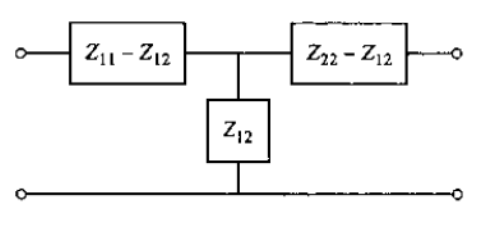

### pi型电路等效

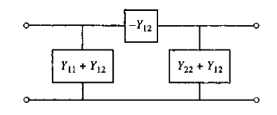

### 串联/并联

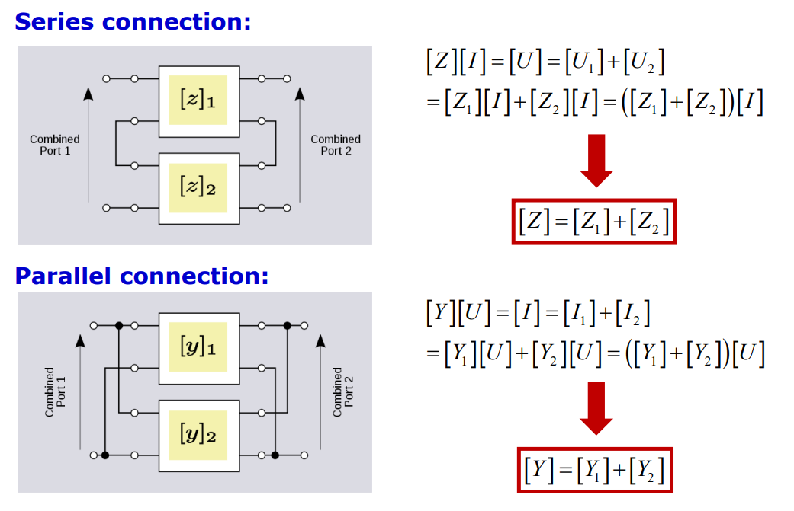

### 端接下的输入阻抗

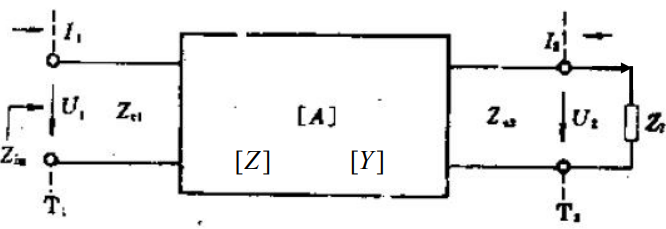
$$
Z_{in}=Z_{11}-\dfrac{Z_{12}Z_{21}}{Z_{22}+Z_l}
\\Y_{in}=Y_{11}-\dfrac{Y_{12}Y_{21}}{Y_{22}+Y_l}
$$

$$
Z_{in}=\dfrac{AZ_l+B}{CZ_l+D}
\\z_{in}=\dfrac{az_l+b}{cz_l+d}
$$

* 输出开路：$Z_{in,oc}=\dfrac{A}{C}=Z_{11}, Y_{in,oc}=Y_{11}-\dfrac{Y_{12}Y_{21}}{Y_{22}}$
* 输出短路：$Z_{in,oc}=\dfrac{B}{D}=Z_{11}-\dfrac{Z_{12}Z_{21}}{Z_{22}}, Y_{in,oc}=Y_{11}$

## ABCD矩阵（传输矩阵）

### 定义

注意输出电流方向

ABCD矩阵之所以这么定义，也是为了式子的方向与图中的方向一致，便于级联

### ABCD矩阵性质

* 互易：AD-BC=1

* 互易无耗：A, D纯实数，B, C纯虚数

* 对称：A=D

  

### Z/Y转ABCD

### ABCD转Z/Y

$$
[Z]=\dfrac{1}{C}\begin{bmatrix}
  A & AD-BC  \\ 
  1 & D 
\end{bmatrix}
$$

$$
[Y]=\dfrac{1}{B}\begin{bmatrix}  D & -(AD-BC)  \\   -1 & A \end{bmatrix}
$$

### 常见电路ABCD矩阵

## 归一化阻抗

### 归一化电压电流

将每个端口的电压电流与该端口的传输线阻抗进行归一化，使得输入功率可以用归一化电压u来表示
$$
u=\dfrac{U}{\sqrt{Z_0}}, i=I\sqrt{Z_0}
\\u^+=\dfrac{1}{2}(u+i), u^-=\dfrac{1}{2}(u-i)
\\P=\dfrac{1}{2}Re(UI^*)=\dfrac{1}{2}Re(ui^*)=\dfrac{1}{2}Re((u^++u^-)(u^+-u^-)^*)
\\=\dfrac{1}{2}Re(|u^+|^2-|u^-|^2+u^-(u^+)^*-u^+(u^-)^*)
\\=\dfrac{1}{2}(|u^+|^2-|u^-|^2)=P^+-P^-
$$

在这个电压电流体系下，网络的所有阻抗都要归一化：
$$
z=\dfrac{u}{i}=\dfrac{U/I}{Z_0}=\dfrac{Z}{Z_0}
\\y=\dfrac{i}{u}=\dfrac{I/U}{Y_0}=\dfrac{Y}{Y_0}
$$

### 归一化阻抗的Z/Y矩阵

$$
z_{ij}=\dfrac{Z_{ij}}{\sqrt{Z_{0i}Z_{0j}}}
\\y_{ij}=Y_{ij}\sqrt{Z_{0i}Z_{0j}}
$$

### 归一化阻抗的ABCD矩阵

## S参数矩阵

### 定义

求解Sij是时其他端口接上和端口对接的传输线的匹配负载，而不是短路

对匹配的定义？与端口参考阻抗相等

解读：
* S参数是对于**归一化电压**而言的，即电压对应于功率
* Sii是除i端口其他端口都接匹配负载下的i端口反射系数
* Sij是除j端口其他端口（包括i端口）都接匹配负载下的j到i端口的传输系数

### 性质
* 对于互易网络，S矩阵是**对称阵**，Sij=Sji（涉及到虚数要加共轭吗？应该是不加的）

* 对于互易无损耗网络，S是**正交矩阵**，即S的转置的共轭是S的逆，$SS^{*t}=I$，有两个条件，模值条件和相位条件

   * 矩阵每一列单位向量

   * 每一列之间正交

   * 对于二端口网络

      

* 对于互易无源网络 

   

### 端接下的输入反射/输入阻抗/负载功率
根据输出端阻抗，$\Gamma_L=\dfrac{V_2^+}{V_2^-}$，根据S参数列出式子
$$
\Gamma_{in}=S_{11}+\dfrac{S_{12}S_{21}\Gamma_l}{1-S_{22}\Gamma_l}
\\Z_{in}=\dfrac{1+\Gamma_{in}}{1-\Gamma_{in}}Z_0
$$

注意输入反射不一定等于S11，只有在其他端口匹配下才是

负载功率：

* 首先是输入端的第一次反射$P_{av}(1-|\Gamma_g|^2)$
* 然后是输出端的反射$P_{av}(1-|\Gamma_g|^2)|S_{21}|^2(1-|\Gamma_l|^2)$
* 然后是输出端看输入端的反射系数：$\Gamma_{out}=S_{22}+\dfrac{S_{12}S_{21}\Gamma_g}{1-S_{11}\Gamma_g}$，反射功率又反射回来$P_{av}(1-|\Gamma_g|^2)|S_{21}|^2|\Gamma_l|^2|\Gamma_{out}|^2$
* 最后负载功率$P_l=P_{av}(1-|\Gamma_g|^2)|S_{21}|^2(1-|\Gamma_l|^2+|\Gamma_l|^2|\Gamma_{out}|^2)$

还有一种全列方程的解法

* S参数两方程
* 负载一方程
* 输入端口电流$i=v^+-v^-,v=v^++v^-,iR_s+v=V_s$ 一方程

### 通用解法

**方法1**：每个端口单独算，给一个电压，测量所有端口（接匹配负载）的电压电流，转换成S参数（如果有n个端口，相当于要算n个电路）

转换成S参数即$v^+=V/\sqrt{Z_0}+I\sqrt{Z_0},v-=V/\sqrt{Z_0}-I\sqrt{Z_0}$

**方法2**：用电路理论的方法，就是猛猛列方程，消元

例子：对于T功分器

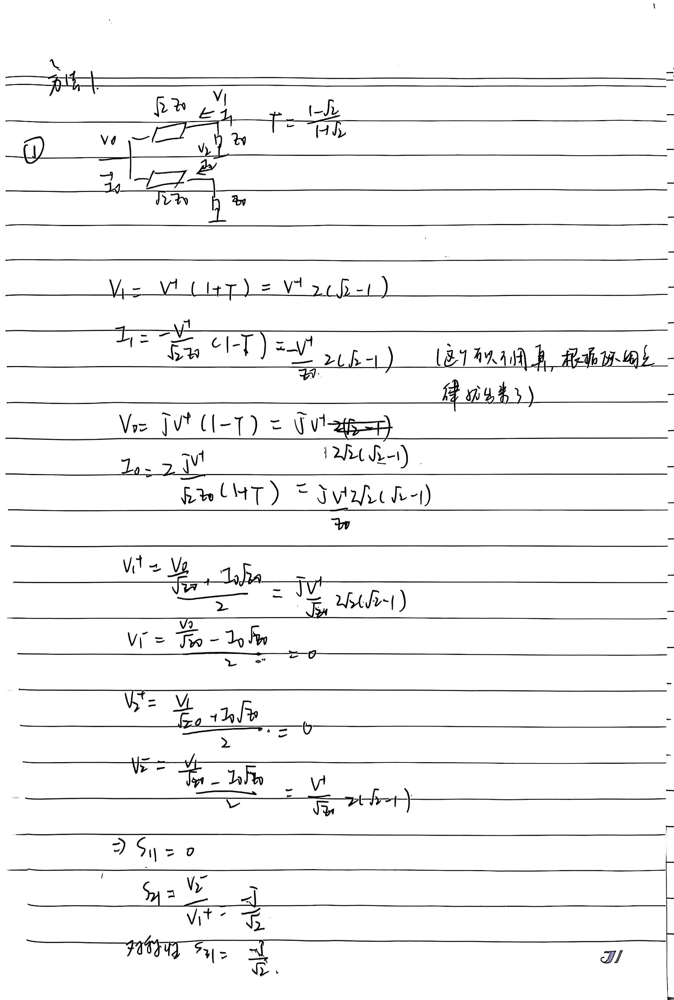

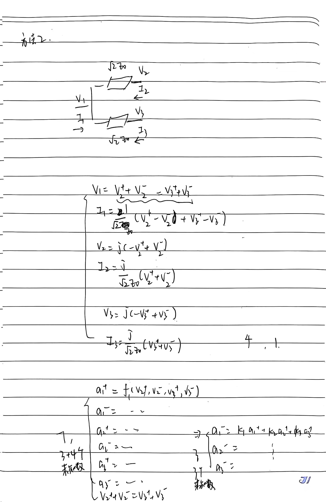

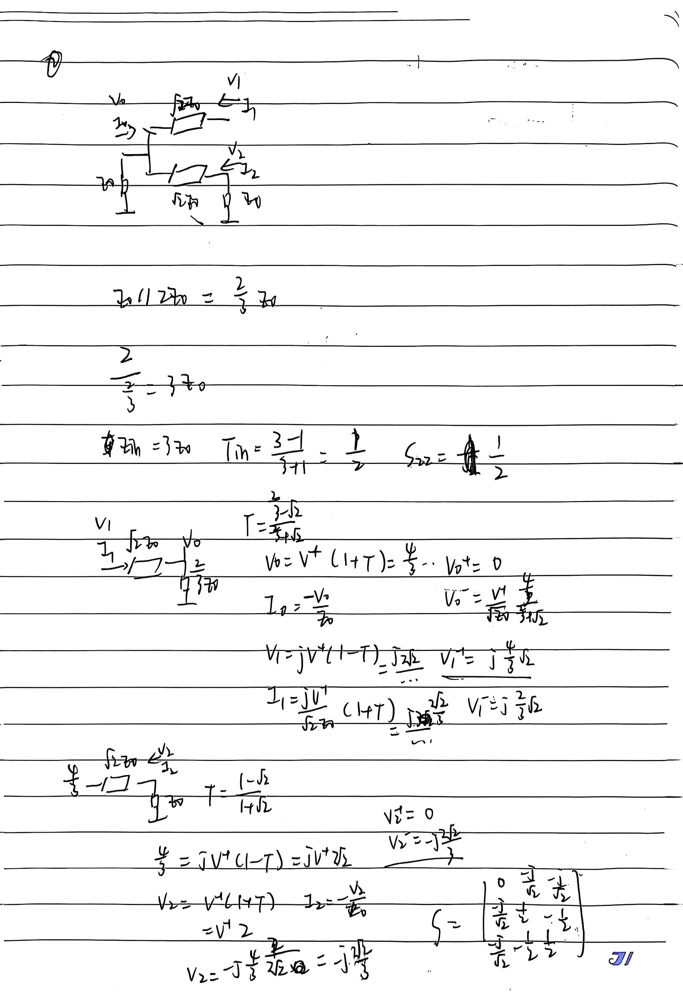

### 端口参考面平移（deembed）

参考面平移不会对S的绝对值产生影响，只会造成相位旋转

### 多器件连接后S参数
1. 各器件分别的S参数

   

2. 各器件之间的连接（比如一个器件一个端口的负输出是一个器件一个端口的正输入）

3. 连接后S参数

### 级联下的S参数

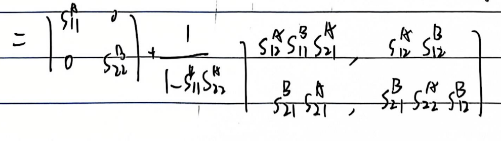

## 矩阵互转

p192

## 对称电路分析

### 网络对称性

除了互易网络自带的$Z_{ij}=Z_{ji}$和对称网络的$Z_{ii}=Z_{jj}$外

* 二端口：

  * 一个对称轴

* 四端口

  * 一个对称轴：$Z_{21}=Z_{43},Z_{31}=Z_{42},Z_{41}=Z_{32}$；也就是矩阵关于正对角线和副对角线都对称

    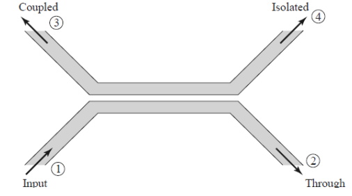

  * 两个对称轴：就像正方形的对角也相连了一样，只要边的长度相等，Z就相等

    

上面的Z换成S也成立，也具有这样的对称性

### 方法

对称结构可以对角化，分析eigenmode（奇偶模）
就可以解耦，对每一种模式有电壁磁壁边界条件进行分析（场分析，不仅仅是电路分析，因为不同模式有不同的场分布，传播系数之类可能会不同）

比如四端口：

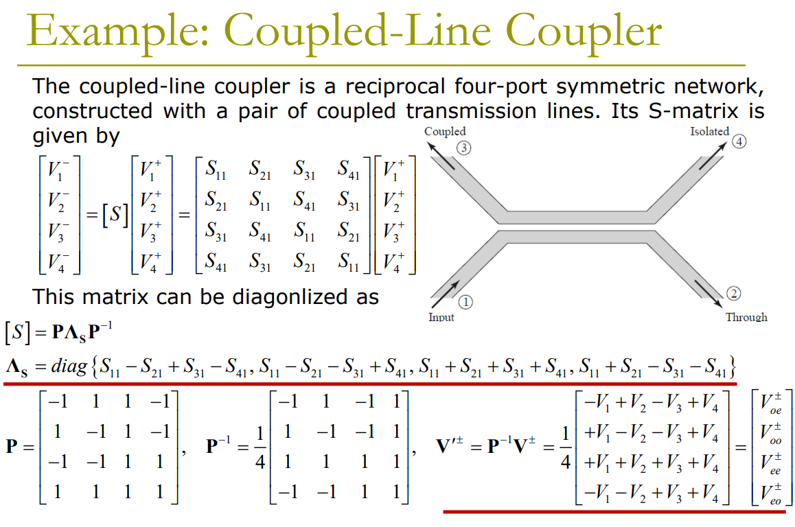

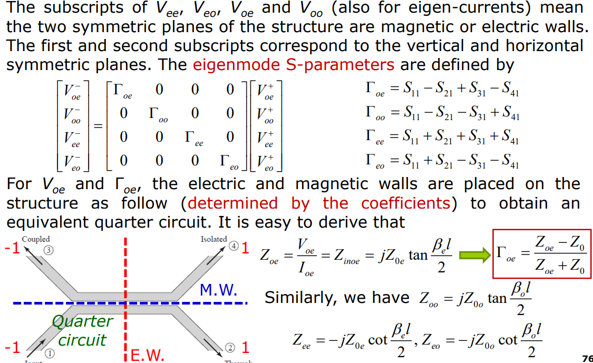

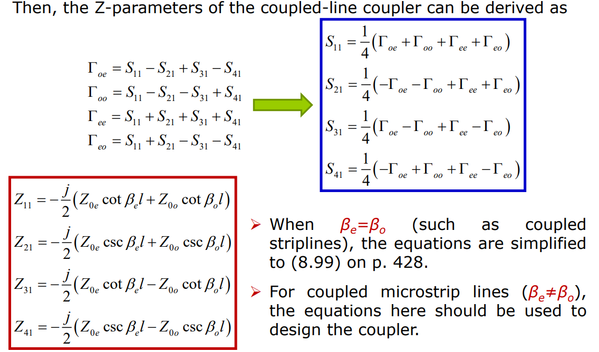

## 信号流图

方便S参数网络的计算（需要端接负载）
### 二端口网络

### 负载

### 源

### 简化规则

