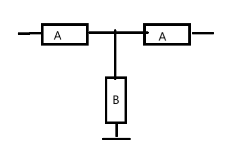
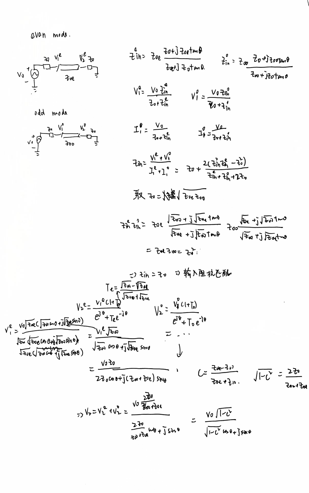
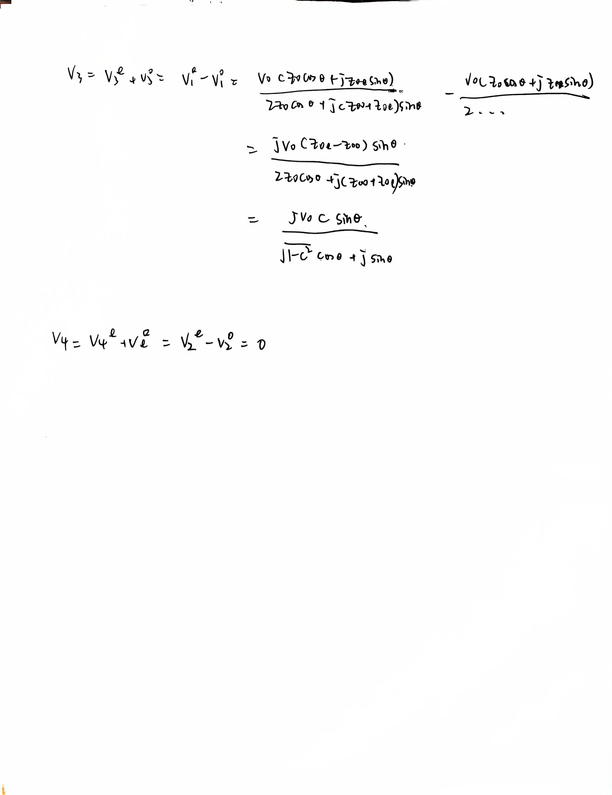

# 微波器件

## 二端口器件：衰减器/移相器

### 传输线S参数

设传输线阻抗=$kZ_0$， $\Gamma_g=\dfrac{1-k}{1+k}$，则\
$$
S_{21}=4e^{-j\beta l}\dfrac{k}{(1+k)^2-e^{-2j\beta l}(1-k)^2}
\\S_{11}=\dfrac{-\Gamma_g(1-e^{-2j\beta l})}{1-\Gamma_g^2e^{-2j\beta l}}
=\dfrac{(k^2-1)(1-e^{-2j\beta l})}{(1+k)^2-(1-k)^2e^{-2j\beta l}}
$$
对于$\dfrac{m\lambda}{4}$的传输线，$S_{21}$的相位确实就是传输线的电长度

### 反射型衰减器/移相器推导

### 匹配但有耗：衰减器

#### 阻性衰减器

$$
B=\dfrac{2A}{1-A^2}
\\
[S]=\begin{bmatrix}
  0& \tfrac{1-A}{1+A}  \\ 
  \tfrac{1-A}{1+A}& 0 
\end{bmatrix}
$$

#### 反射型衰减器

### 匹配且无耗：移相器

#### 传输线移相器

#### 反射型移相器

## 三端口器件: 功分器
三条件不可得兼：
* 各端口匹配：S参数对角元素为0
* 互易：S参数为对称阵
* 无损：S参数每一列模方为1，且互相正交

### 放弃互易性：circulator

满足匹配与无损

可以作为TX/RX天线的发射接收选择，这样就可以双工

### 放弃一些端口的匹配：T-junction功分器

满足互易与无损

当用来当天线的功分器/功率合成器时，因为输出端口不隔离，如果天线没有那么匹配，会有很大的影响

相当于威尔金森功分把电阻去掉
$$
[S]=\begin{bmatrix}
 0 & \tfrac{-j}{\sqrt{2}} & \tfrac{-j}{\sqrt{2}} \\ 
 \tfrac{-j}{\sqrt{2}} & \tfrac{1}{2} & -\tfrac{1}{2}\\
 \tfrac{-j}{\sqrt{2}} & -\tfrac{1}{2} & \tfrac{1}{2} 
\end{bmatrix}
$$

### 放弃无耗：阻性功分器

满足互易与匹配

损失一半功率

### 输出端口间隔离：wilkinson功分器
各端口匹配，互易，且当输出匹配的时候无耗，而且23端口隔离

但作为功率合成器的时候，输出功率不是等于两路功率的叠加，因为要看两路的相位
$$
[S]=\dfrac{-j}{\sqrt{2}}\begin{bmatrix}
 0 & 1 & 1  \\ 
 1 & 0 & 0 \\
 1 &0 &0
\end{bmatrix}
$$

## 四端口网络：定向耦合器
三条件可以得兼：
* 各端口匹配
* 互易
* 无耗

优点：

* 输出端口的反射功率不会进入到临近的端口（耦合端），而是到输入端和隔离端
* 可以任意比例功率分配（当等功率分配时，隔离端接匹配负载后的三端口器件的S参数形式跟威尔金森功分器一样，相当于隔离端实现了有耗）
* 可以实现加法器/减法器

### 定义

### 指标

端口：

1. 输入端
2. 直通端
3. 耦合端
4. 隔离端

### 3dB混合耦合器（Hybrid coupler）

一半功率分配，90度或0度或180度相位差输出

#### 分支线耦合器（branch-line coupler）（正交耦合器）

#### Hybrid Ring（rat race coupler）（环形耦合器）

加法器和减法器

### 耦合线耦合器
#### 推导：奇偶模分解

解耦后，分为共模（偶模）和差模（奇模）；于是拆成两个传输线模型，一个传输偶模，一个传输奇模

#### 设计
* 带状线：偶模和奇模相速相同
* 微带线：偶模和奇模相速不同（场分布不同导致等效介电常数不同）

注意端口位置和上面的耦合器不一样

常用于功率分配（分一点功率用来检波）

高速信号模型：3端口近端串扰，4端口远端串扰

**基本条件**：

**端口电压**：（k是耦合系数）

在耦合线长度四分之一波长时，耦合端和直通端是正交的（相位差90度），同时耦合端/源端刚好是C

设计：

在微带耦合线设计中，为了补偿奇偶模，会加补偿电容，电容实现可以就是耦合线突出来一片更近的金属片

#### 计算过程

### 波导magic-T耦合器

### 过桥耦合器（crossover）

