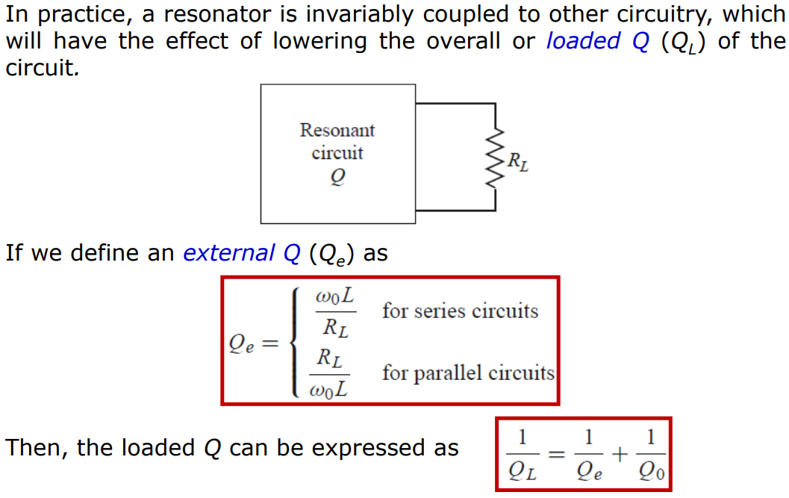
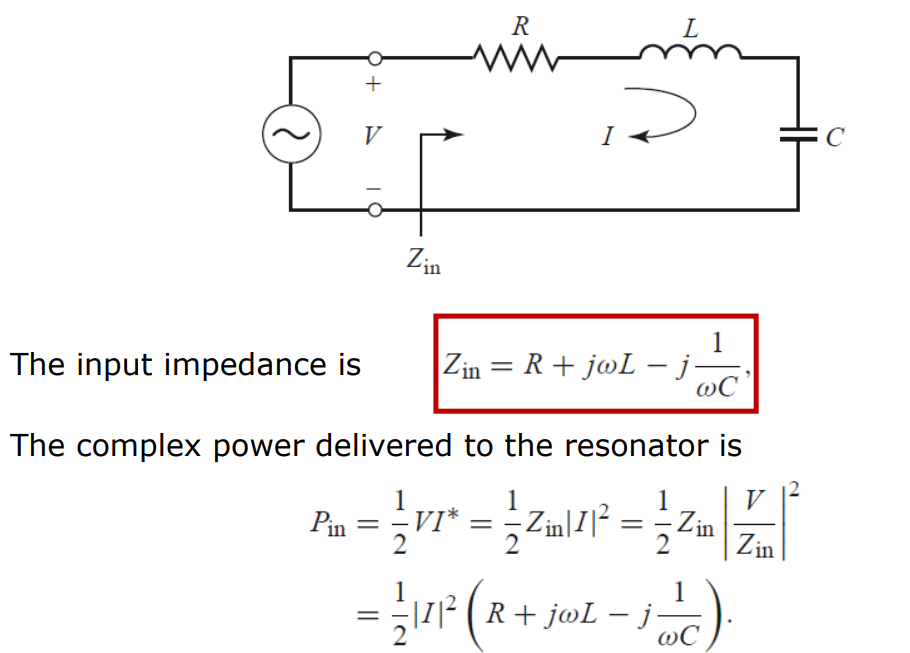
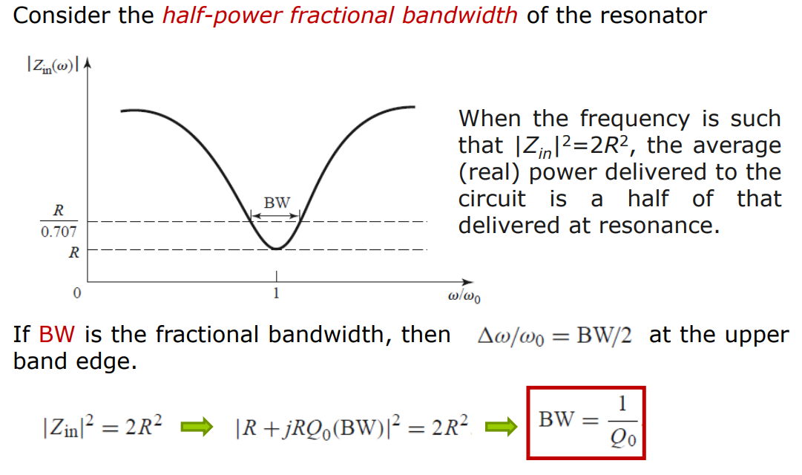
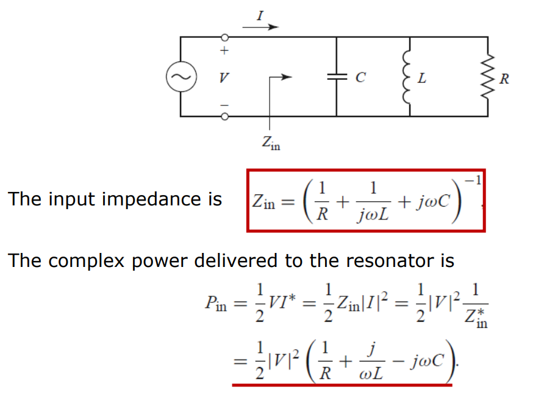
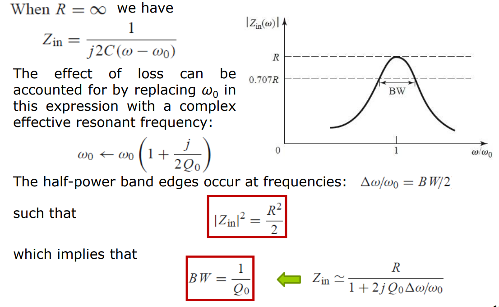

# 微波谐振器
## 应用
* 选频（加入放大电路就是振荡器）

## 品质因素Q 

### 定义

$$
Q=w\dfrac{W_m+W_e}{P_l}\\\dfrac{1}{Q}=\dfrac{1}{Q_c}+\dfrac{1}{Q_d}+\dfrac{1}{Q_r}
$$

对于Q的理解，可以是给谐振器输入的平均功率的Q倍就是谐振器的储能xw

### 3dB分数带宽

根据对串联谐振器和并联谐振器的讨论，可以发现分数带宽都满足这一形式：
$$
\dfrac{\Delta w}{w}=\dfrac{1}{Q_0}
$$
Q值大，损耗小，带宽小，频率选择性强

### 外接负载的品质因素

比如串联谐振接了一个非常大的电阻，那么电流就很小，Q也很小

比如并联谐振接了一个非常小的电阻，那么电压就很小，Q也很小

## 串联谐振器

### 输入阻抗

在谐振点阻抗最小

**输入阻抗**在谐振点w0的一阶近似：
$$
\dfrac{dZ_{in}}{dw}|(w=w_0)=jL+j\dfrac{1}{w_0^2C}=2jL
\\
Z_{in}=R+2jL\Delta w=R(1+2jQ_0\dfrac{\Delta w}{w_0})
$$

对于任意谐振器：
$$
Z_{in}=R(w)+jX(w)
$$

定义等效电抗参数（单位是阻抗ohm）：
$$
x=\dfrac{w_0}{2}\dfrac{dX}{dw}|(w=w_0)
\\=w_0L=\dfrac{1}{w_0C}
$$
**输入阻抗**在谐振点w0的一阶近似：
$$
\dfrac{dZ_{in}}{dw}|(w=w_0)=j\dfrac{dX}{dw}=2j\dfrac{x}{w_0}
\\Z_{in}=R+2jx\dfrac{\Delta w}{w_0}
$$

### 谐振条件

其中输入阻抗的广义形式：$Z_{in}=\dfrac{P_l+2jw(W_m-W_e)}{0.5|I_{in}|^2}$

谐振点定义在阻抗的极值点：
$$
W_m=W_e
\\w_0=\dfrac{1}{\sqrt{LC}}
$$

### 品质因素

$$
Q_0=w_0\dfrac{2W_m}{P_l}=\dfrac{\sqrt{L/C}}{R}=\dfrac{w_0L}{R}=\dfrac{1}{w_0RC}
\\=\dfrac{x}{R}
$$

### 3dB分数带宽

## 并联谐振器

### 输入导纳

在谐振点导纳最小

**输入导纳**在谐振点w0的一阶近似：
$$
\dfrac{dY_{in}}{dw}|(w=w_0)=jC+j\dfrac{1}{w_0^2L}=2jC
\\
Y_{in}=G+2jC\Delta w=G(1+2jQ_0\dfrac{\Delta w}{w_0})
$$

对于任意谐振器：
$$
Y_{in}=G(w)+jB(w)
$$

定义等效电纳参数：
$$
b=\dfrac{w_0}{2}\dfrac{dB}{dw}|(w=w_0)
\\=w_0C=\dfrac{1}{w_0L}
$$
**输入导纳**在谐振点w0的一阶近似：
$$
\dfrac{dY_{in}}{dw}|(w=w_0)=j\dfrac{dB}{dw}=2j\dfrac{b}{w_0}
\\Y_{in}=G+2jb\dfrac{\Delta w}{w_0}
$$

### 谐振条件

$$
W_m=W_e\\w_0=\dfrac{1}{\sqrt{LC}}
$$

### 品质因素

$$
Q_0=\dfrac{w_0C}{G}=\dfrac{1}{\tfrac{w_0L}{R}}
$$

### 3dB分数带宽

Q值大，损耗小，带宽小，频率选择性强

## 传输线谐振器

### 串联谐振器

参数：$Z_0,\beta, \alpha$，谐振频率下电长度$\theta=\beta l$

* 终端短路：$\theta = k\pi$
* 终端开路：$\theta=(k+\dfrac{1}{2})\pi$

阻抗
$$
Z_{in}=Z_0(\alpha l+j\theta\dfrac{\Delta w}{w_0})
$$

品质因素：
$$
Q=\dfrac{\theta}{2\alpha l}=\dfrac{\beta}{2\alpha}
$$

谐振点：

* 终端短路：$w=kw_0$
* 终端开路：$w=(2k+1)w_0$

### 并联谐振器

参数：$Y_0,\beta, \alpha$，谐振频率下电长度$\theta=\beta l$

* 终端开路：$\theta = k\pi$
* 终端短路：$\theta=(k+\dfrac{1}{2})\pi$

导纳
$$
Y_{in}=Y_0(\alpha l+j\theta\dfrac{\Delta w}{w_0})
$$

品质因素：
$$
Q=\dfrac{\theta}{2\alpha l}=\dfrac{\beta}{2\alpha}
$$

谐振点：

* 终端开路：$w=kw_0$
* 终端短路：$w=(2k+1)w_0$

### 半波长短路传输线谐振器（近似串联谐振器）

* **输入阻抗**

* **Quality Factor**

注意传输线谐振器有一系列谐振点，如果只是要选一个频率，注意要把其他频率点压制掉
### 四分之一波长短路传输线谐振器（近似并联谐振器）

### 半波长开路传输线谐振器（近似并联谐振器）

## 常见微带谐振器

## 谐振腔
### 矩形谐振器

相当于终端短路的矩形波导谐振器，类似上面的终端短路传输线谐振器，只不过另一端也短路了

最低TE谐振模TE101，最低TM谐振模TM110；也就是至少两个下标不为0。TM110和TE101的区别只是参考面选取不同

**Q值**：

### SIW谐振器
只支持TEm0l

### 谐振器Q值测量
* 单端
* 双端
（TODO）

### 谐振腔激励
* 耦合
* 探针
* 电流环

## 激励耦合
### 微带线的gap耦合
相当于串一个电容

### 矩形波导的aperture耦合
* 如果是宽边变窄，相当于并联电感
* 如果是窄边变窄，相当于并联电容

### 矩形波导的探针激励

同样也是单螺调谐的模型

源就相当于串联在电感旁边

### 参数扰动带来的谐振频率变化

比如用上次那个测血糖的例子，如果谐振器的能量在待测介质的分布更多，那么谐振频率变化更大$\Delta w \propto \dfrac{\Delta \epsilon V_1}{\epsilon V_0}$，但是因为待测介质是高损耗的，所以Q值会减小$Q\propto \dfrac{\epsilon V_0}{\sigma V_1}$，带宽会变大。最后谐振频点下的阻抗变化其实不随场的分布改变$\Delta Z\propto \dfrac{\Delta \epsilon}{\sigma}$，也就是与待测介质本身的Q值成正比（前提是损耗都发生在待测介质内，当场分布过于集中在谐振器内时，会导致损耗基本发生在谐振器，那么介质介电常数变化导致阻抗变化会更小）