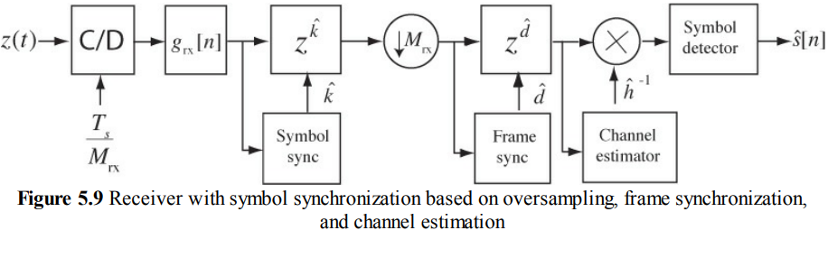

#   数字调制

## 发射调制
发射机结构：

* **symbol mapping**：比特流$\{b[n]\}$映射到符号流$\{s[n]\}$，其中$s[n]\in C=\{c_0,...,c_{M-1}\}$，C称为星座（constellation），一般用复数表示（也可能是向量或矩阵，在MIMO情况）。**决定了信息速率1baud=lgMbit，以及星座排列紧密程度和SNR一起决定误码率**，比如16-QAM比16-PSK排列紧密，相同SNR下误码率小
* **pulse shaping**：将离散序列$\{s[n]\}$映射到连续时间信号$x(t)=\sum s[n]g_{tx}(t-nT)$，其中$g_{tx}(t)$是无ISI的波形（采样点除原点都为0）。**决定了传输带宽2B=(1+a)R**
* **功率放大**：$x(t)=\sqrt{E_x}\sum s[n]g_{tx}(t-nT)$。**SNR=Ep/N0 决定了误码率**。然后在相同误码率和码元速率下，lg功率和信息速率线性相关，比如一个码元lgMbit，需要M倍功率传输。这样一看，加进制其实不大划算，功率加的有点多。如果要实现相同高的信息速率，可以提高lgM倍带宽同时提高lgM倍功率。个人感觉，BPSK，QPSK的效率都还可以，再加就纯属用功率换带宽了。但是当接收机很近，path loss很小的时候，的确信噪比很高，不加进制太浪费了。

**发射归一化**条件使发射码元平均能量为$E_x$，也就是发射信号平均功率$E_x/T$:
* 对于符号流，$R_s[0]=1$。对于均值为0的就是$\sigma_s^2=1$
	* 归一化星座图方法：$C_\alpha=\alpha\{c_0,...,c_{M-1}\}$，其中$\alpha=1/\sqrt{\dfrac{1}{M}\sum |c_k|^2}$
* 对于发射码元波形，能量=$\int |g_{tx}(t)|^2dt=1$

**接收归一化**条件：
* $g(0)=1$
* 复噪声密度为$N_0$，每通道噪声密度为$\dfrac{N_0}{2}$

### Symbol Mapping and Constellations
由两部分组成
* bit to symbol mapping：codebook=>symbol。常用gray code，使得相邻星座只相差一个bit，就算误码也误码的bit少一些
* set of symbols：星座集$C=\{c_0,...,c_{M-1}\}$决定了一个码元传输几bit数据

常用星座集：
* **BPSK**：$C=\{+1,-1\}$
* **M-PAM**：延长版BPSK: $C=\{-\dfrac{M-1}{2},...,-\dfrac{1}{2},\dfrac{1}{2},...,\dfrac{M-1}{2}\}$
* **QPSK**：$C=\{+1,-1,+j,-j\}$（又叫4-QAM）
* **M-PSK**：$C=\{e^{\tfrac{j2\pi k}{M}}\}$
* **M-QAM**：$C=\{...,k+jl,...\}$，其中$k,l\in \{-\dfrac{1}{2}-(\dfrac{\sqrt{M}}{2}-1),...,-\dfrac{1}{2},\dfrac{1}{2},...,\dfrac{1}{2}+(\dfrac{\sqrt{M}}{2}-1)\}$（未归一化）

### 发射信号功率谱密度
$$
x(t)=\sqrt{E_x}(\sum_n s[n]\delta(t-nT))\otimes g_{tx}(t)
$$
进行一通运算后，
$$
S_x(f)=\dfrac{E_x}{T}|G_{tx}(f)|^2\sum_n R_s[n]e^{-j2\pi nfT}
$$

对于用IID建模且均值为0的符号流（前后符号正交），且归一化$R_s[0]=1$
$$
S_x(f)=\dfrac{E_x}{T}|G_{tx}(f)|^2
$$

而且归一化条件码元平均能量=$\int |g_{tx}(t)|^2dt=1$，所以平均功率
$$
P_x=\int S_x(f)df=\int \dfrac{E_x}{T}|G_{tx}(f)|^2df=\dfrac{E_x}{T}
$$

对于均值不为0的但是不相关的码元
$$
S_x(f)=\dfrac{E_x}{T}|G_{tx}(f)|^2+(\dfrac{m_x}{T})^2\sum |G_{tx}(\dfrac{n}{T})|^2\delta(f-\dfrac{n}{T})
$$

## 发射接收滤波器（pulse shape design）

选取合适发射和接收滤波器，使SNR最大且无ISI
### 理论推导
为简化问题，假设信道响应完全平坦，path loss带来的功率衰减为原来的1/L倍
然后再加一个归一化条件，就是噪声功率谱密度为N0，也就是每个通道噪声功率谱密度为N0/2，这会要求接收端增益为$\sqrt{2}$（因为下变频前噪声密度N0/2，xcos会变成N0/4，归一化为N0/2需要x根号2）

接收滤波器后的信号是
$$
y(t)=\sqrt{\dfrac{E_x}{2L}}g_{rx}(t)\otimes g_{tx}(t)\otimes \sum_m s[m]\delta(t-mT)+g_{rx}(t)\otimes (\sqrt{2}LPF(v(t)e^{-j2\pi f_ct}))
$$
令接收码元能量$E_p=\dfrac{E_x}{2L}$

采样后
$$
y[n]=\sqrt{E_p}\sum_m s[m]g((n-m)T)+\tilde{v}[n]
\\=\sqrt{E_p}s[n]g(0)+\sqrt{E_p}\sum_{m\ne n} s[m]g((n-m)T)+\tilde{v}[n]
$$
其中$\tilde{v}[n]=\int \sqrt{2}v(\tau)e^{-j2\pi f_c\tau}g_{rx}(nT-\tau)d\tau$

开始分析信噪比SINR：
信号能量（根据码元能量归一化条件）：
$$
E(|\sqrt{E_p}s[n]g(0)|^2)=E_p|g(0)|^2
$$
ISI能量：
$$
E_{ISI}=E(|\sqrt{E_p}\sum_{m\ne n} s[m]g((n-m)T)|^2)
$$
让这一部分最小化，就直接让g(t)除了原点以外的采样值都为0

噪声能量：
假设白噪声$v(t)$频谱为$\dfrac{N_0}{2}$
$\sqrt{2}v(t)e^{-j2\pi f_ct}$是$v(t)$的功率谱密度x2，卷积滤波器后频谱变成$N_0|G_{rx}(f)|^2$
能量：
$$
E(|\tilde{v}[n]|^2)=N_0\int |G_{rx}(f)|^2df
\\=N_0\int |g_{rx}(t)|^2dt
$$

考虑了ISI干扰的信噪比：
$$
SINR=\dfrac{E_p|g(0)|^2}{N_0\int |g_{rx}(t)|^2dt+E_{ISI}}
$$

开始用cauchy-schwarz定理求最值：
$$
|g(0)|^2=|\int g_{rx}^*(-t)g_{tx}(t)dt|^2
\\\le \int |g_{tx}(t)|^2dt\int |g_{rx}(t)|^2dt
\\=\int |g_{rx}(t)|^2dt（根据归一化码元能量条件）
$$

所以在无ISI下，信噪比最大值：
$$
SNR=\dfrac{E_p}{N_0}
$$
当且仅当$g_{rx}(t)=kg_{tx}(-t)$时满足
(注意这是正交双通道下的SNR，如果BPSK只需要单通道（在严格同步下），那么噪声减半，SNRx2；但如果还是正交采，还是上述SNR)

再加上接收归一化条件$g(0)=1$，则$\int g_{rx}^*(-t)g_{tx}(t)dt=\int k|g_{tx}(t)|^2dt=1$，则$k=1$，就是matched filter的形式
$$
g_{rx}(t)=g_{tx}(-t)
$$

最后接收滤波后信号是
$$
y[n]=\sqrt{E_p}s[n]+\tilde{v}[n]
$$
其中$\tilde{v}[n]=g_{rx}(t)\otimes (\sqrt{2}v(t)e^{-j2\pi f_ct})$，噪声能量$E(|\tilde{v}[n]|^2)=N_0\int |g_{rx}(t)|^2dt=N_0=\sigma_v^2$，可证明不同采样点噪声不相关，所以噪声分布可抽象为$N_C(0,\sigma_v^2)\iff f_v(x)=\dfrac{1}{\pi\sigma_v^2}e^{-\tfrac{|\tilde{x}|^2}{\sigma_v^2}}$
下面是证明：
$$
R_{vv}[k]=E(\tilde{v}[n]\tilde{v}^*[n+k])
\\=E(\int \int v(\tau_1)v^*(\tau_2)g_{rx}(nT-\tau_1)g_{rx}^*((n+k)T-\tau2)d\tau_1d\tau_2)
\\=\sigma_v^2\int g_{rx}(nT-\tau)g_{rx}^*((n+k)T-\tau)d\tau
\\=\sigma_v^2\int g_{rx}(-\tau)g_{rx}^*((kT-\tau)d\tau
\\=\sigma_v^2\int g_{tx}(\tau)g_{rx}^*((kT-\tau)d\tau
\\=\sigma_v^2g(kT)
=\sigma_v^2\delta[k]
$$

### 无ISI频谱设计
根据接收归一化条件$g(0)=1$，无ISI即$g[n]=\delta[n]$
即DTFT为1
即CTFT的周期叠加为T
$$
\sum_k G(f-\dfrac{k}{T})=T
$$
要求频谱设计在$\pm \dfrac{R}{2}$(R=1/T)处滚降对称

常见频谱设计：
* $Trect(f/(R/2))\iff sinc(\pi Rt)$
* 升余弦谱$\iff sinc(\pi Rt)\dfrac{cos(\pi\alpha t)}{1-4(R\alpha t)^2}$（下降速度更快）

### 发射与接收滤波器
$$
g_{rx}(t)=g_{tx}(-t)
$$

在设计为了简化把相位抹去，如果发射滤波器频谱相位为0，那么接收滤波器也是，那么只有实部，偶对称，那么发射滤波器和接收滤波器的频谱相同，也就是$\sqrt{G(f)}$

最后导致发射和接收滤波器冲激响应都是偶对称的非因果实信号，一般在数字域处理

如果选取升余弦谱，那么带宽$B=\dfrac{1+\alpha}{2T}$
冲激响应：

### 滤波器数字实现
#### 发射机pulse shaping
$$
g_{tx}[n]=g_{tx}(nT_x)
$$

#### 接收机matched filtering
$$
g_{rx}[n]=T_rg_{rx}(nT_r)
$$

## 判决（symbol detection）
### 最优判决区域
判决前的信号：
$$
y[n]=\sqrt{E_p}s[n]+\tilde{v}[n]
$$
其中噪声分布为$N_C(0,\sigma_v^2)\iff f_v(\tilde{x})=\dfrac{1}{\pi\sigma_v^2}e^{-\tfrac{|\tilde{x}|^2}{\sigma_v^2}}$

比如二值判决：
$$
H_1:s[n]=c_1
\\H_0:s[n]=c_0
$$

其中
$$
P(H=H_1)=p_1,P(H=H_0)=p_0
\\f(y|H_1)=\dfrac{1}{\pi\sigma_v^2}e^{-\tfrac{|y[n]-\sqrt{E_p}c_1|^2}{\sigma_v^2}}
\\f(y|H_0)=\dfrac{1}{\pi\sigma_v^2}e^{-\tfrac{|y[n]-\sqrt{E_p}c_0|^2}{\sigma_v^2}}
$$
判决方法：**假设检验**，scaled conditional probabilities的比较：

最后变成scaled距离的判决（主要因为噪声是高斯模型，别的模型不是这样），如果信源模型中码元是等概的，那么就变成星座图上离星座的距离的判决。最后可以变成复平面的判决区域（**最优判决区域**）

### 误码率
假设$S_n$代表判决$c_n$的区域，$S=\{S_n\}$是所有区域的集合，那么误码率即
$$
P_e=\sum_n p_n\int_{y\in (S-S_n)}f(y|H_n)dy
$$

对于高斯噪声下的等概二元判决
$$
P[c_m\rightarrow c_l]=Q(\sqrt{\dfrac{E_p}{N_0}\dfrac{|c_m-c_l|^2}{2}})
$$
其中$Q(x)=\dfrac{1}{\sqrt{2\pi}}\int_x^{\infty}e^{-t^2/2}dt$

一个有用的估计：$Q(x)\le \dfrac{1}{2}e^{-x^2/4}$

对于任意M进制星座图，首先不等概误码率一定小于等概的，然后对于等概的可以估计一个误码率上界：因为等概二元判决一定比等概M元判决积分面积大，所以上界用二元判决来估算：
$$
P_e\le \sum_n\dfrac{1}{M}\sum_{l\ne n}Q(\sqrt{\dfrac{E_p}{N_0}\dfrac{|c_n-c_l|^2}{2}})
$$
用星座间最小距离进一步进行估计：令$d_{min}=min(|c_n-c_l|)$，则
$$
P_e\le \sum_n\dfrac{1}{M}(M-1)Q(\sqrt{\dfrac{E_p}{N_0}\dfrac{d_{min}^2}{2}})
\\=(M-1)Q(\sqrt{\dfrac{E_p}{N_0}\dfrac{d_{min}^2}{2}})
$$

* 例：等概BPSK
$C=\{+1,-1\}$
$$
P_e=Q(\sqrt{\dfrac{E_p}{N_0}\dfrac{|c_1-c_0|^2}{2}})
\\=Q(\sqrt{\dfrac{2E_p}{N_0}})
$$

* 例：二进制极性码与非极性码比较：
假设接收码元$E_p$能量相同，也就是信噪比相同，归一化后极性码星座间距为$2$，非极性码星座间距为$\sqrt{2}$，所以后者误码率要大

* 例：M-QAM
$C=\{...,k+jl,...\}$，其中$k,l\in \{-\dfrac{1}{2}-(\dfrac{\sqrt{M}}{2}-1),...,-\dfrac{1}{2},\dfrac{1}{2},...,\dfrac{1}{2}+(\dfrac{\sqrt{M}}{2}-1)\}$
首先归一化$\alpha=1/\sqrt{\dfrac{1}{M}\sum |c_k|^2}=\sqrt{\dfrac{6}{M-1}}$，则$|d_{min}|^2=\dfrac{6}{M-1}$
则
$$
P_e\le (M-1)Q(\sqrt{\dfrac{E_p}{N_0}\dfrac{3}{M-1}})
$$
可以发现，对于相同误码率，M进制大概对应M倍的码元能量

M-QAM exact solution:
$$
P_e=4(1-\dfrac{1}{\sqrt{M}})Q(\sqrt{\dfrac{E_p}{N_0}\dfrac{3}{M-1}})-4(1-\dfrac{1}{\sqrt{M}})^2[Q(\sqrt{\dfrac{E_p}{N_0}\dfrac{3}{M-1}})]^2
$$

## 同步
首先讨论频域平坦信道（只有衰减与延时）
有三个impairment:

* 码元同步
  * 采样的时间点$\tau_d$
  * 码元的相位$2\pi f_{offset}t+\phi$
    * 频偏
    * 恒定相位

* 帧同步
* 信道衰减与相移

然后对于频率选择性信道（不平坦）
还需要先进行信道估计，然后进行均衡（补偿掉信道频域的不平坦），之后再进行同步

### 码元同步

也就是确保采样时间准确，且载波同步（恢复载波相位与频率）

分为：

* 外同步。比如前导码/导频
* 内同步。比如manchester编码

下面仅讨论数字实现方法：
* 采样率高的时候，直接用算法估计
* 采样率低但是仍然比信号nyquist频率高的时候，使用升采样（包括滤波/插值）使采样率提高，然后再用算法估计（注意这里的滤波一定要线性相位，FIR自带这一特效）

使用最高能量法，也就是 选取$\tau_d\in [0,T)$ 使得$max(\sum_{n=0}^{N} \dfrac{1}{N}|g(nT+\tau_d)|^2)$

我的看法就是先检测阈值，超阈值之后开始码元同步，选取合适的采样点

然后载波同步需要已知的前导码来消除相位偏差，如果不用已知的前导码，就需要差分编码之类来消除相位模糊。

### 帧同步

码元同步之后不一定一开始就是帧开始，所以还需要帧同步。

帧同步的原理就是检测帧头。这个帧头/前导码可以是一组特殊序列，或者干脆就是星座图与数据不同的星座

### 信道估计

## 信道频响均衡