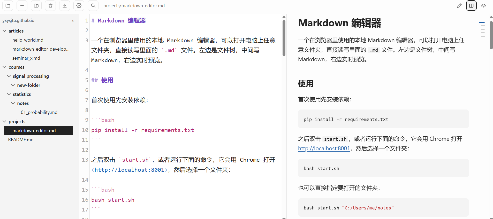
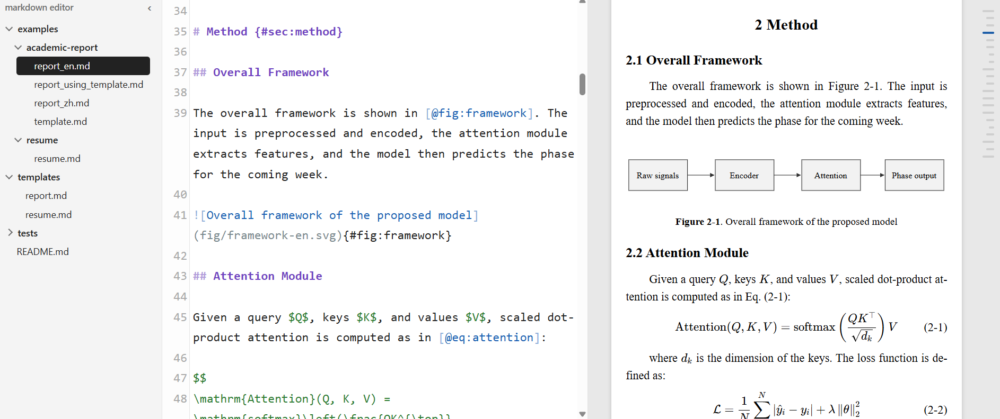
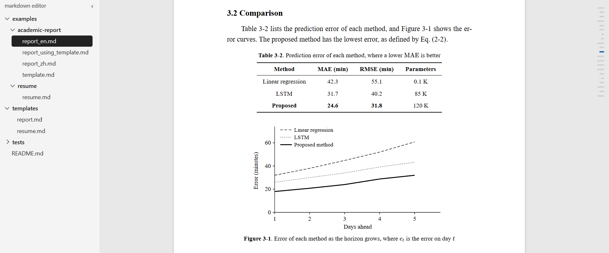
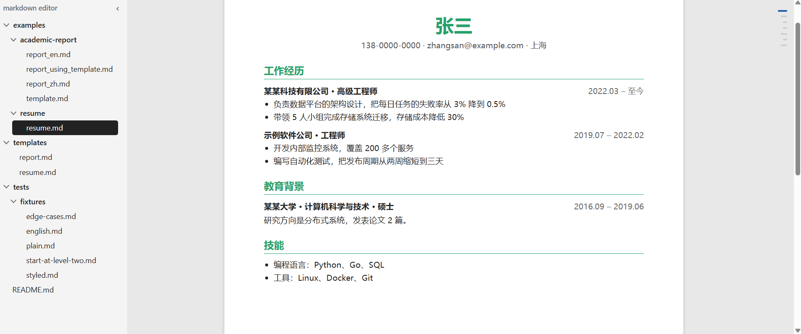

<!-- 下面的内容由 build.py 从 C:/Users/asus/Desktop/markdown editor/README.md 自动同步，在这里改会被覆盖，请改源文件 -->

# Markdown 编辑器

一个在浏览器里使用的本地 Markdown 编辑器，可以打开电脑上任意文件夹，直接读写里面的 `.md` 文件。左边是文件树，中间写 Markdown，右边实时预览。支持自定义样式，比如学术报告，简历等。






## 使用

首次使用先安装依赖：

```bash
pip install -r requirements.txt
```

之后双击 `start.sh`，或者运行下面的命令，它会用 Chrome 打开 <http://localhost:8001>，然后选择一个文件夹：

```bash
bash start.sh
```

也可以直接指定要打开的文件夹：

```bash
bash start.sh "C:/Users/me/notes"
```

按 Ctrl+C 停止编辑器。编辑器还开着时再运行脚本，只会多打开一个窗口；多个窗口可以各开一个文件夹。

## 功能

- 公式（`$...$`、`$$...$$`）、代码高亮、表格、脚注、任务列表，预览随编辑区滚动
- 视频：单独一行写 `@[youtube](网址或视频ID)` 或 `@[bilibili](网址或BV号)`，预览里显示播放器，可以在后面加 `"标题"`。链接里的开始时间和 B 站分 P 会保留。打印和 PDF 里放不了视频，显示成视频网页的地址
- 自动保存，也可以按 Ctrl+S；文件被其他程序改过时会询问，不会悄悄覆盖
- 预览框右侧有目录缩略条（2 个以上标题时显示），鼠标悬浮时展开，也可以用图钉固定；点标题时预览和编辑区一起跳转。折叠起来的 `<details>` 里的标题不放进目录，在预览里展开它时才加进去；导出的 HTML 目录和 PDF 书签也一样，按 `<details>` 默认是否展开（`open`）来定
- 在左边的文件树里，拖拽可以把文件或文件夹移到别的文件夹，双击可以重命名。同名时会拒绝，不会覆盖。把文件移到别的文件夹时，它引用的、放在同一文件夹里的图片（包括录音和视频）会一起搬过去，按引用里写的位置放：写的是 `_images/a.png` 就放进新位置的 `_images`，写的是 `fig/a.png` 就放进 `fig`，搬空的图片文件夹会删掉。别的文件也在用的图片复制一份，不会搬走；新位置已有同名但内容不同的图片时不覆盖，给搬过去的图片换个名字并改好文件里的引用。网址、指向上级文件夹（`../`）的图片和普通链接不会动，路径也不会改
- 工具栏的扫帚按钮清理未使用的图片：列出没有被任何 Markdown 或 HTML 文件引用的图片、录音和视频，带缩略图，可以取消勾选想留下的，确认后移到系统回收站，删错了能恢复。选中一个文件夹时只清理它，否则清理整个打开的文件夹；判断有没有被用时看整个打开的文件夹，`../` 跨文件夹的引用也算。删除前会再检查一遍，这期间被用上的图片不会删。编辑时删掉图片引用不会自动删图片，因为撤销、剪切粘贴时引用会暂时消失
- 按 Ctrl+V 粘贴截图等图片，默认保存到 Markdown 文件所在文件夹下的 `fig` 文件夹并插入 Markdown 引用；文件夹名和保存位置（文件所在文件夹或打开的根文件夹）可以在 Settings 里修改。如果剪贴板里同时有文字（比如从 Excel 复制），会按文字粘贴
- 换行就是换段，不用像标准 Markdown 那样空一行。想在同一段里换行（写诗、地址），在行尾加两个空格或反斜杠 `\`。单独占一行的图片总是自成一段，和上下文字隔开；和文字写在同一行的图片（比如小图标）不受影响。编号模板里，这样的图片有图题时也会成为编号的图。加粗、链接等跨行写时不会被拆开；紧凑列表（列表项之间没有空行）里的换行显示成换行而不是新段落
- `+` 新建文件，它右边的按钮新建文件夹。窗口里分别填所在文件夹和名字，默认叫 `untitled` 并选中名字（文件不含后缀），直接打字就能改；所在文件夹不存在时会自动创建，文件不写后缀时自动加 `.md`。新文件开头会写好 `date: 当天日期` 和一个以文件名为标题的一级标题；搬运旧日记时把日期改掉就行。重名时自动在后面加编号，比已有的最大编号大 1（已有 `a.md` 和 `a (1).md` 时创建 `a (2).md`）。两者默认建在选中的文件夹里；没选中时建在当前文件所在的文件夹
- 表格里按 Enter 新增一行并整理对齐（中文按两个英文字符宽度计算），在最后的空行再按一次 Enter 退出表格。只处理以 `|` 开头、第二行是分隔行的表格
- 工具栏的放大镜（或 Ctrl+H）打开查找替换小窗，Ctrl+F 只显示查找，Esc 关闭。这两个快捷键只在编辑和分屏视图生效，预览视图下仍是浏览器自己的功能。可以区分大小写、全词匹配和用正则表达式；用正则时替换内容可以写 `$1`、`$&`、`\n`。全部替换可以一次撤销
- 列表里按 Tab 往里缩进一级，子项一起移动，Shift+Tab 往外退一级
- 编辑区可以折叠：标题折叠到下一个同级或更高级的标题之前，HTML 标签（比如很长的 `<details>`）折叠到它的结束标签。鼠标移到编辑区上，行号右边会出现箭头，点它折叠；折叠后点箭头或 `…` 展开。查找到折叠里面的内容时会自动展开。折叠只影响显示，不改文件，切换文件后不保留
- 工具栏的导出按钮可以导出当前内容（包括还没保存的改动）：Markdown 直接下载；HTML 是单个文件，样式和本地图片都嵌在里面，有 2 个以上标题时带目录，公式样式需要联网加载；PDF 由本机的 Chrome 或 Edge 直接生成并下载，带书签目录；两个浏览器都没有时才用打印窗口（选“另存为 PDF”，没有书签）
- 文件树可以多选：按住 Ctrl 点文件或文件夹，或者从空白处（右边缘或底部）按住左键拖出一个框。之后可以一起拖到别的文件夹，或者一起删除。拖动没选中的项时只移动它自己；文件夹和它里面的文件都选中时，只操作文件夹；同名时那一项不移动，其他项照常
- 垃圾桶把选中的文件和文件夹移到系统回收站，可以恢复；没选中时移动当前打开的文件。单击文件夹选中它，单击文件或文件树的空白处取消选中
- 预览里点相对路径的 `.md` 链接，会直接打开那个文件
- 文件开头的 frontmatter 不显示在正文里，其中的 `title`、`date`、`tags` 显示在预览顶部。写 `pdf-bookmarks: false` 时，导出的 PDF 不带书签，默认带。模板文件里也可以写，文档写的优先
- 保留文件原有的换行符，不是 UTF-8 编码的文件会拒绝打开，避免存坏

## 模板

### 学术报告
在文件开头写 `template: report`，预览就会变成毕业论文和学术报告的版式，并自动给标题、图、表、公式编号。其他文件不受影响。字体、字号、编号格式等都可以改，见后面的“自定义样式”。它是一个普通的模板，就是 `templates/report.md` 和 `report.css`，编号和交叉引用来自内置的 `numbered`。例子在 `examples/academic-report` 里，打开这个文件夹就能看到效果。

### 学术文章
写 `template: article` 是英文学术文章的版式，照 LaTeX 默认的 article 类（12pt）排：Computer Modern 字体，题目和作者居中，段首不缩进、段落之间空一点，两端对齐，章节标题加粗并编号成 1、1.1，图、表、公式全文连续编号（Figure 1、Eq. (1)）。默认 A4、四边 1 英寸，写 `paper: Letter` 就和美国的 LaTeX 默认一样。字体是 `templates/fonts` 里的 Latin Modern（Computer Modern 的开源版），不用自己安装。它和 `report` 一样基于 `numbered`，选项见 `templates/article.md`。例子在 `examples/academic-article` 里。

导出 PDF 时英文不会自动断词：Chrome 生成 PDF 用的是一个全新的配置，没有断词词典，所以两端对齐的行间距有时会比 LaTeX 稍大，内容也会稍长一点。

```markdown
---
template: report
title: 报告题目
author: 张三             # 多位作者写成 [张三, 李四]
affiliation: 某某大学
date: 2026-11-06
abstract: 摘要内容
keywords: 关键词一, 关键词二
lang: en                # 英文报告才需要，图题等会变成 Figure、Table
---

# 引言 {#sec:intro}

{#fig:arch}

如[@fig:arch]所示，结果见[@tbl:result]，公式见[@eq:energy]，详见[@sec:intro]。

: 实验结果 {#tbl:result}

| 方法 | 误差 |
| --- | --- |
| A | 1.2 |

$$
E = mc^2
$$ {#eq:energy}
```

| 内容 | 写法 | 结果 |
| --- | --- | --- |
| 标题 | `#`、`##`、`###`，可选 `{#sec:名字}` | 1、1.1、1.1.1。文章最高一级的标题算第一级 |
| 不编号的标题 | 末尾写 `{-}` | “摘要、参考文献、致谢”这些标题自动不编号，它们下面的小节也不编号 |
| 附录 | 一级标题写 `# 附录` 或 `# 附录：问卷`，英文写 `# Appendix` | 依次编号为 `附录 A`、`附录 B`，小节是 `A.1`、`A.1.2`，里面的图、表、公式是 `图 A-1`、`表 A-1`、`(A-1)` |
| 图 | 单独成段或单独占一行的 ``，可选 `{#fig:名字}` | 图题在图下方，`图 2-1`。没写图题的图片不编号 |
| 表 | 紧贴表格前后的一段 `: 表题`（和表格之间空一行），可选 `{#tbl:名字}` | 表题在表上方，`表 2-1`，三线表。没写表题的表格不编号 |
| 公式 | `$$ ... $$`，可选 `{#eq:名字}` | 编号靠右，`(2-1)`。末尾写 `{-}` 不编号 |
| 图组 | 见下面的例子 | 共用一个图号，每张图是一个子图，子标题显示为 `(a) 说明` |
| 代码块 | 开头一行写 ` ```python title="a.py" {#lst:名字} ` | 标题在代码上方，`代码 2-1  a.py`，英文是 `Listing 2-1`。写了 `title` 或标签才编号，只写语言不编号 |
| 图片大小 | 图片后面写 `{width=60%}` 或 `{#fig:名字 width=8cm}`，单位是 `%`、`cm` 或 `mm` | 高度按比例自动算。百分比相对于版心，图组里相对于格子。写错的宽度会被忽略 |
| 分页 | 单独一行写 `\newpage` | 预览显示一条虚线，打印和导出 PDF 时才分页 |
| 换行 | 行尾两个空格，或者行尾写 `\`，也可以写 `<br>` | 段内换行 |
| 引用 | `[@fig:名字]`、`[@tbl:名字]`、`[@eq:名字]`、`[@lst:名字]`、`[@sec:名字]` | 变成可点击的编号，比如 `图 2-1`。标签写错会标红 |

多张图排成几行几列时，用 `:::` 把它们包起来，最后一段文字是总标题：

```markdown
::: figures {#fig:compare cols=2}
{#fig:a}
{#fig:b}
{#fig:c}
{#fig:d}

两组实验结果的对比
:::
```

`cols` 是每行的图片数（默认 2，最多 6），行数按图片数量自动算。图片会缩放到等宽，高宽比不同时在格子里垂直居中。`[@fig:compare]` 显示 `图 2-1`，`[@fig:a]` 显示 `图 2-1(a)`。

工具栏的导出按钮选 PDF，会直接下载这个版式的 PDF，带页码。30 行以内的代码块尽量整块放在一页，更长的会跨页，每页的框各自闭合。`\newpage` 总是强制换页，如果前面的内容刚好跨到新的一页，那一页后面就会留白。PDF 阅读器的侧边栏里有书签目录，显示一到三级标题，点击可以跳转。脚注目前显示在文章末尾，不在每页底部。

默认版式：A4，边距上下 2.54cm、左右 3.17cm；正文宋体小四（英文 Times New Roman），1.5 倍行距，首行缩进两字；题目黑体二号，一、二、三级标题黑体三号、四号、小四；图题、表题和表格五号。这些默认值写在 `templates/report.md` 里，打开它就能预览效果。要改样式用不着动它，见下面的“自定义样式”。

图、表、公式按章编号，第一个标题之前的内容没有章号，就直接编 `图 1`。参考文献目前要自己手写，不会自动生成。

#### 自定义样式

不用写 CSS，在 frontmatter 的 `style` 里写要改的项就行，没写的项保持默认：

```markdown
---
template: report
style:
  font-size: 五号
  heading-1-align: left
  numbering: "2.1"
---
```

如果多份文档要用同一套样式，可以把它放到单独的模板文件里，比如 `my-school.md`：

```markdown
---
extends: report
style:
  body-font: Times New Roman, KaiTi
  page-margin: 3cm 2.5cm
---

这里写示例内容。打开这个文件，看到的就是模板的效果。
```

然后在文档里写路径。文档自己的 `style` 仍然可以覆盖个别项，优先级是：`report` < 模板文件 < 文档的 `style`。

```markdown
---
template: ./my-school.md
style:
  heading-1-align: center
---
```

- `template` 写名字是模板库里的模板，比如 `report`、`resume`，见下面的“模板库”；以 `./`、`../` 开头或以 `.md` 结尾的是模板文件，路径相对于当前文档，必须在打开的文件夹里。
- 模板文件开头必须写 `extends`，见下面的“模板怎么组成”。模板只提供 `style`、`css`、`lang` 和 `pdf-bookmarks`，正文、题目和作者不会进入文档。
- 模板文件读不出来时，文档按普通文档显示，预览顶部有警告。
- 导出时样式会嵌进 HTML 和 PDF，不需要带上模板文件。改了模板文件后，切换一下文档或编辑一下内容，预览才会更新。
- 写错的选项名或值会列在预览顶部，这一项不生效，其他项照常。值都经过检查，所以 `style` 不会注入任意样式。

例子是 `examples/academic-report` 里的 `template.md` 和 `report_using_template.md`。

下面是 `report` 的选项。`paper`、`page-margin`、`page-numbers` 所有模板都能用，编号格式和称呼来自 `numbered`，其余是 `report.css` 里的变量。

| 选项 | 含义 | 写法 |
| --- | --- | --- |
| `paper` | 纸张大小 | `A3`、`A4`、`A5`、`B5`、`Letter` |
| `page-margin` | 页边距 | 和 CSS 一样写 1 到 4 个长度：`2.5cm` 四边相同，`2.54cm 3.17cm` 上下、左右，`3cm 2.5cm 2.5cm 3cm` 上、右、下、左。单位是 `cm`、`mm`、`in`、`pt` |
| `page-numbers` | PDF 是否显示页码 | `true`、`false` |
| `page-number-font`、`page-number-size` | 页码的字体和字号，默认 10.5pt 的 Times New Roman | `Article Roman`、`12pt` |
| `body-font` | 正文字体 | 用逗号分隔。英文字体写在前面，中文才会用后面的字体：`Times New Roman, KaiTi` |
| `font-size` | 正文字号 | `12pt` 或 `小四`，字号名从 `初号` 到 `六号` 都可以 |
| `line-height` | 行距 | 倍数 `1.5`，或固定值 `20pt` |
| `first-line-indent` | 首行缩进 | `2em`，`0` 表示不缩进 |
| `heading-font` | 题目和所有标题的字体 | 写法和 `body-font` 一样 |
| `title-font`、`title-size`、`title-align` | 题目的字体、字号、对齐 | 对齐写 `left`、`center`、`right`、`justify` |
| `heading-1-font`、`heading-1-size`、`heading-1-align` | 一级标题的字体、字号、对齐 | 二、三级把 `1` 换成 `2`、`3` |
| `caption-size`、`caption-align` | 图题、表题和代码标题的字号、对齐 | |
| `table-rule`、`cell-border` | 表格上下两条线、格子的边框 | 默认是三线表（`1.5pt solid #000` 和 `0`）。两项都写 `.75pt solid #000` 时，每个格子都有边框 |
| `numbering` | 图、表、公式、代码的编号格式 | `"2-1"`（默认）、`"2.1"`，`"1"` 表示全文连续编号，不带章号 |
| `chapter-format` | 一级标题的编号格式 | `"第{}章"` 显示 `第1章`，`"第{cn}章"` 显示 `第一章`（1 到 99），`[@sec:名字]` 也会跟着变 |
| `figure-label`、`table-label`、`code-label`、`appendix-label` | 图、表、代码、附录的称呼 | `Fig.` 显示 `Fig. 2-1`。不想要空格时写 `"图{}"`，显示 `图2-1` |

### 模板怎么组成

模板文件的 `extends` 决定它从哪里开始，可以一层层继承：

```text
none       内置，普通文档
numbered   内置，加上标题、图、表、公式的自动编号和交叉引用
report     templates/report.md，extends: numbered，再加上 report.css 的外观
my-school  你写的模板，extends: report，只写要改的项
```

- `extends` 的写法和 `template` 一样：写名字，或者写路径。路径相对于写它的那个文件。
- 每一层的 `style` 和 `css` 都生效，后面的优先。每一层的 `css` 路径都相对于它自己的文件。
- 只有 `none` 和 `numbered` 是写在编辑器代码里的，其他都是普通文件。`extends: numbered` 只有编号和图组这些必要的版式（`templates/numbered.css`），外观是普通文档的，由你的 CSS 决定。
- 循环继承时，预览顶部有警告，文档按普通文档显示。

### 从零写一个模板

想要和报告完全不同的版式（比如简历），写一个模板文件和一个 CSS 文件就行，不用改编辑器。例子是 `templates/resume.md` 和 `templates/resume.css`。需要编号时把 `extends: none` 换成 `extends: numbered`，`templates/report.md` 就是这样写的。

模板文件 `template.md`：

```markdown
---
extends: none
css: ./template.css
style:
  accent: "#1a5fb4"
  font-size: 五号
  paper: A4
  page-margin: 15mm 18mm
  page-numbers: false
---

这里写示例内容。打开这个文件，看到的就是模板的效果。
```

样式文件 `template.css`，路径相对于模板文件：

```css
& { font-size: var(--font-size); }
h1 { color: var(--accent); text-align: center; }
h2 { border-bottom: 1px solid var(--accent); }
```

文档写 `template: ./template.md`，还可以在自己的 `style` 里改 `accent`。

- **选择器**：直接写 `h1`、`p`、`.date`，只影响文档内容，不影响编辑器界面。`&` 表示文档本身。这些规则的优先级比默认样式高，不用加前缀。
- **变量**：CSS 里写了 `var(--accent)`，`accent` 就是一个可以在 `style` 里设置的选项，这样用模板的人不用碰 CSS。默认值写在模板文件的 `style` 里。值里不能有 `; : { } < >` 和链接，字号可以写 `小四`。CSS 里没用到的名字会提示 `Unknown style option`。名字以 `-size`、`-align`、`-font` 结尾的，会按字号、对齐和字体检查，写错了有提示。
- **页面**：纸张、边距和页码用 `paper`、`page-margin`、`page-numbers` 设置，CSS 里写 `@page` 不生效。
- **字体和图片**：CSS 不能联网，`url()` 可以写 `data:`，也可以指向模板旁边的字体和图片，比如 `url(./fonts/x.woff2)`（woff2、woff、otf、ttf、png、jpg、gif、webp，每个不超过 2 MB）。渲染时它们会被直接写进样式，所以预览、导出的 HTML 和 PDF 都能用；不能用 `../` 离开模板所在的文件夹。例子是 `templates/article.css`。
- **页头**：`extends: none` 时，默认的题目、日期和标签页头仍然会显示，不想要时可以不写这些字段，或者写 `.doc-head { display: none; }`。基于 `numbered` 时，题目、作者和摘要显示在正文开头，可以用的 class 见下面的“模板能用的 class”。
- **基于报告**：写 `extends: report` 再加 `css`，编号、交叉引用和报告的所有选项都保留，CSS 再覆盖外观。子模板的 CSS 写在后面，直接写 `h1` 就能盖过 `report.css`。
- **加 class**：用模板的文档（基于 `none` 或 `numbered` 都可以）还能用下面的两种写法，给内容加上 class，再由 CSS 决定样式：
  - `[文字]{.date}` 生成 `<span class="date">`，比如 `### 公司 [2020 – 至今]{.date}`。写在标题里时，公司和日期可以用 CSS 分到左右两边，但这段文字也会进入 PDF 书签，不想要时写 `pdf-bookmarks: false`。
  - 单独一行的 `::: contact` 到 `:::` 之间的内容放进 `<div class="contact">`，里面可以写任意 Markdown。可以写几个名字（`::: job current`）；要嵌套时外层多写几个冒号（`:::: outer`）。
  - 只能加 class，`{#id}`、`{style=...}` 这些写法不生效，会原样显示。没有用模板的普通文档不支持这两种写法，也会原样显示。
  - 基于 `numbered` 时，`::: figures` 仍然是图组，块里的标题、图和表照常编号，`[文字]{.类名}` 里可以写引用：`[见 [@fig:a]]{.note}`。引用本身不能直接加 class，`[@fig:a]{.note}` 里的 `{.note}` 会原样显示。
- **联网和安全**：CSS 不能加载外部内容，`@import` 和指向网址的 `url()` 都不允许，字体只能用电脑上装的（`@font-face` 里写 `local(...)`），图片只能写 `url(data:...)`。字符串以外不能写反斜杠。文件有这些问题或括号不配对时，整个 CSS 都不用，预览顶部会说明原因。模板 CSS 不能运行脚本，但可以改变文档的显示内容，别人给的模板要留意这一点。
- **浏览器**：需要 Chrome 或 Edge 120 以上，更旧的版本不认识这种写法，模板 CSS 里的规则不会生效。


### 模板能用的 class

基于 `numbered` 时，这些 class 可以写进模板的 CSS：

| 内容 | class |
| --- | --- |
| 题目、作者、单位、日期 | `doc-title`、`doc-author`、`doc-affiliation`、`doc-date` |
| 摘要、关键词和它们的标签 | `doc-abstract`、`doc-keywords`、`front-label`，它们都在 `front-matter` 里 |
| 标题前的编号 | `heading-number` |
| 图、图组、子图 | `figure`、`figure-group`、`figure-grid`、`subfigure` |
| 所有图题、表题和代码标题 | `caption`，分别还有 `figure-caption`、`table-caption`、`code-caption`、`subfigure-caption`，其中的“图 2-1”是 `caption-label` |
| 公式和它的编号 | `equation`、`equation-number` |
| 引用，写错的引用 | `xref`，`xref-missing` |
| 分页符，很长的代码块 | `page-break`，`code-long` |

### 模板库

模板文件放到 `templates` 文件夹里，就能按名字用，不用写路径：

```markdown
---
template: resume
---
```

编辑器会依次找：

1. 打开的文件夹下的 `templates/resume.md`，适合只在这个项目里用的模板
2. 编辑器目录下的 `templates/resume.md`，在任何文件夹里都能用

模板文件的写法和前面一样，`css` 的路径相对于模板文件。可以先在文档旁边写好模板文件，调到满意后移进 `templates` 文件夹。

- 名字就是文件名去掉 `.md`，只能有文字、数字、`_`、`-` 和中间的空格，不能带路径。
- 打开的文件夹里的同名模板优先。这个文件夹里写 `templates/report.md`，就能改掉 `report`，它可以写 `extends: report`，继承编辑器自带的那个，只改几项。
- `none` 和 `numbered` 是内置的，不能覆盖。
- 写错名字时，预览顶部会列出现在可用的名字。
- 编辑器目录下的 `templates` 不会被 git 忽略，自己加的模板要提交或者自己备份。

## 测试

改了模板、编号或样式的代码后，运行单元测试，不需要额外安装：

```bash
python -m unittest discover tests
```

改了 `templates` 或 `static/document.css` 里的样式时，再比较一下 PDF，看版式有没有意外的变化。它需要本机的 Chrome 或 Edge，还要安装 `pip install pypdfium2 pillow`。改之前先存基准，改完再比较：

```bash
python tests/compare_pdf.py save
```

```bash
python tests/compare_pdf.py compare
```

## 修改编辑区的颜色

颜色写在 `static/editor.css` 里，搜索 `.cm-s-default` 就能找到。改完保存，刷新编辑器页面就能看到，不用重启。

每一行对应一种语法，`color:` 后面就是颜色。比如把标题改成红色：

```css
.cm-s-default .cm-header { color: #d32f2f; font-weight: 700; }
```

颜色可以写成 `#d32f2f` 这样的十六进制，也可以写 `red`、`blue` 这样的颜色名。还可以改 `font-weight`（`700` 是粗体，`400` 是常规）和 `font-style`（`italic` 是斜体）。

| 要改的内容 | 规则里的名字 |
| --- | --- |
| 标题 | `.cm-header` |
| 一级、二级、三级列表（符号和文字） | `.cm-variable-2`、`.cm-variable-3`、`.cm-keyword` |
| 粗体、斜体、删除线 | `.cm-strong`、`.cm-em`、`.cm-strikethrough` |
| 链接和图片说明、网址 | `.cm-link` 和 `.cm-image-alt-text`、`.cm-url` |
| 代码 | `.cm-comment`，还要同时改 `.cm-comment.cm-math` |
| 公式 | `.cm-math` |
| 转义的 `\` 和后面的符号 | `.cm-formatting-escape` |
| 引用 | `.cm-quote` |
| 表格 | `.cm-table` |
| HTML 标签 | `.cm-tag`、`.cm-bracket`、`.cm-attribute`、`.cm-string` |
| 分隔线 | `.cm-hr` |
| 任务框 `[x]` | `.cm-formatting-task` |
| frontmatter 的字段名 | `.cm-atom` |
| 语法符号：`#`、`**` 和 `*`、反引号、`>`、链接括号 | `.cm-formatting-header`、`.cm-formatting-strong` 和 `.cm-formatting-em`、`.cm-formatting-code`、`.cm-formatting-quote`、`.cm-formatting-link` |

要注意的地方：

- 同一段文字符合多条规则时，文件里靠后的规则优先。列表和表格的规则放在前面，所以它们里面的代码、公式等能显示各自的颜色，调整顺序时要留意。
- `.cm-keyword` 也用于 frontmatter 里的 `true`、`false`，`.cm-string` 也用于 frontmatter 里加引号的文字，它们的颜色会跟着变。
- 这里只影响中间的编辑区。右边预览和导出文件的样式在 `static/document.css` 里（学术报告模板的在 `templates/report.css`），预览代码块的高亮来自 Pygments。

## 说明

- Markdown 怎么变成 HTML 的规则都在 `md_render.py`，不读写文件、不依赖编辑器的其他部分，可以单独拿去用（依赖 markdown-it-py、mdit-py-plugins、Pygments）：`md_render.make_markdown().render(文字)`。带模板的文档用 `doc_render.py` 的 `render_body`，它再用到 `numbered.py`、`template_loader.py`、`template_style.py` 和 `templates/` 里自带的模板。博客 yxysjtu.github.io 也用这几个文件渲染，本机构建博客时会自动复制最新的一份过去，所以两边的编号、图题和模板样式一致。`template_loader.LIBRARY` 是打开的文件夹里放自己模板的文件夹名（默认 `templates`，博客用 `_templates`）。预览的图片地址改写是编辑器专属的，不在里面
- 点右上角的 Settings 可以调编辑区的字号和图片文件夹，配置保存在 `preferences.json` 里，不会提交到 git。
- 只在本机运行，其他网站和其他电脑都不能访问。
- Markdown 里可以写 HTML，但预览和导出时会去掉脚本、`onclick` 这类事件属性和 `javascript:` 链接，打开别人给的文件也不会运行里面的脚本。
- 编辑器组件和公式从 CDN 加载，需要联网。
- 文件树会跳过以 `.` 开头的文件和文件夹，以及 `node_modules`、`__pycache__`、`venv`。
- 最近打开的文件夹记录在 `recent.json` 里，不会提交到 git。
